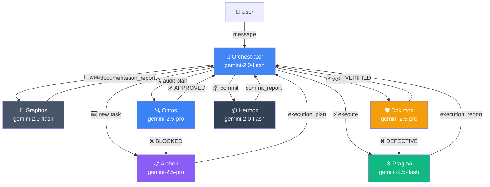
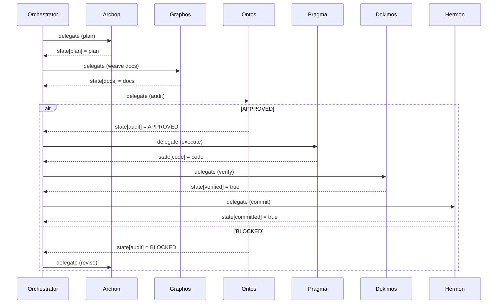
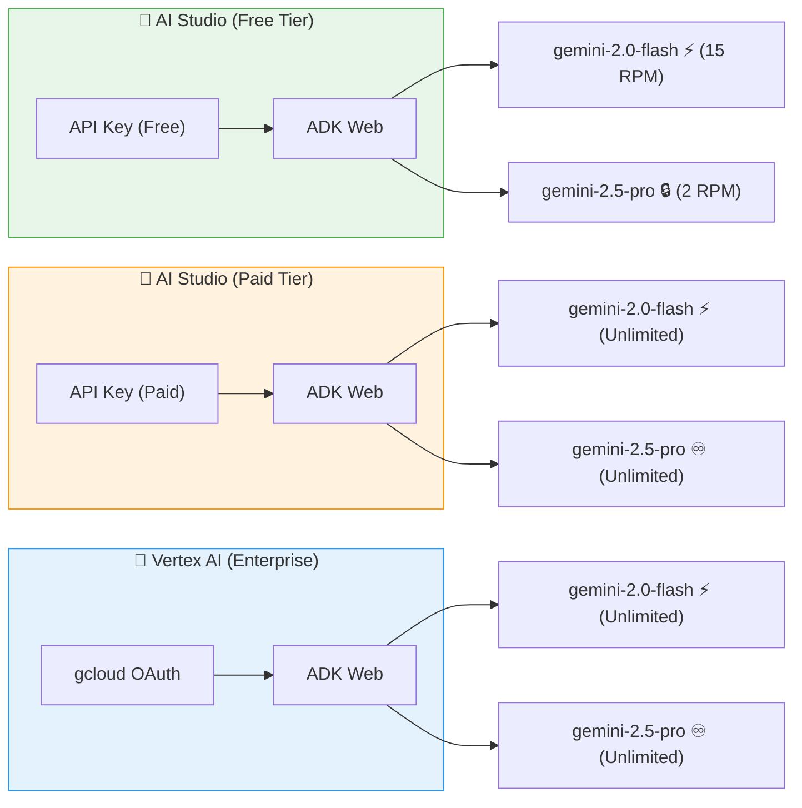
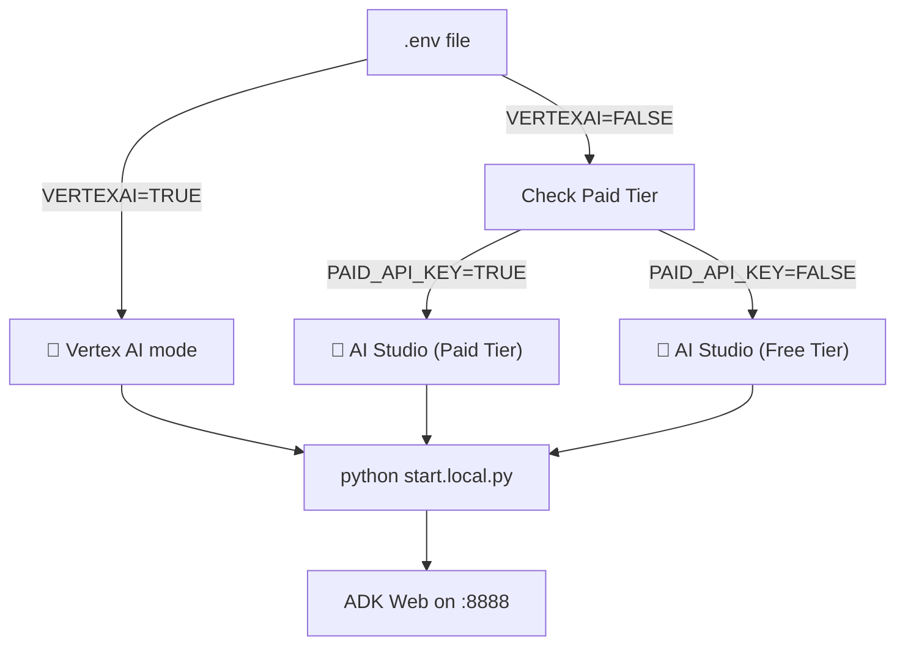

# 🧠 Topos Pipeline V2 — Multi-Agent System

> Powered by [Google ADK](https://google.github.io/adk-docs/) · Python 3.10+ · Linux & Windows

A 6-agent orchestration pipeline that **plans**, **weaves context**, **audits**, **executes**, **verifies**, and **commits** tasks using Google's Agent Development Kit.

---

## 🏛️ Event-Driven MVP Architecture (Docs)

The `/docs/` directory contains the architectural specs for the **ACP Event-Driven Automation MVP**.
This MVP scales the pipeline to enterprise environments using:
- **Frontend Controller (AAP/AWX)**: Uses Ansible AWX inventory to select Linux deployment targets.
- **Anchor MCPs (Anclas MCP)**: Deploying localized, hyper-specific MCPs acting as strict Guardrails derived from ITIL ITSM v5 templates, avoiding EDR and permission blocks.
- **A2A & ACP**: Agent-to-Agent communication under an Administrator Service Account (ACP).

See [`docs/mvp-architecture-awx-mcp.md`](./docs/mvp-architecture-awx-mcp.md) for the complete SDD (Spec Driven Development) outline.

---

## 🏗️ Architecture (V2 Auto-Evolutionary)



### Agent Roles

| Agent | Model | Purpose |
|---|---|---|
| **Orchestrator** | `gemini-2.0-flash` | Routes requests, tracks pipeline state |
| **Archon** | `gemini-2.5-pro` | Strategic Planner — creates execution plans and worktrees |
| **Graphos** | `gemini-2.0-flash` | Knowledge Weaver — maintains chronological rollup docs |
| **Ontos** | `gemini-2.5-pro` | Structural Auditor — validates plans, issues APPROVED/BLOCKED |
| **Pragma** | `gemini-2.5-flash` | Execution Engine — generates code and encapsulates runbooks |
| **Dokimos** | `gemini-2.5-pro` | Verification Engine — tests code, manages Error State Isolation via Git |
| **Hermon** | `gemini-2.0-flash` | Version Control — creates atomic semantic commits |

### Shared State

Agents communicate programmatically via the `output_key` session state dictionary:



---

## Three Authentication Modes




| Feature | 🔑 AI Studio (Free) | 💎 AI Studio (Paid) | 🔐 Vertex AI |
|---|---|---|---|
| Auth method | API Key | API Key | OAuth (auto-refresh) |
| Cost | **Free** with rate limits | Pay-per-token | Pay-per-token |
| `gemini-2.5-pro` limit | 2 RPM (throttled) | **Unlimited** | **Unlimited** |
| `gemini-2.0-flash` limit | 15 RPM (throttled) | **Unlimited** | **Unlimited** |
| Setup time | 2 min | 2 min | 10 min |
| Requires billing | No | Yes | Yes |
| How to tell | `start.local.py` prints `🔑 Mode: AI Studio (Free Tier...)` | `start.local.py` prints `🔑 Mode: AI Studio (Paid Tier...)` | `start.local.py` prints `🔐 Mode: Vertex AI` |

> **🤖 Smart Rate Limiter for Free Tier**
> To prevent `429 RESOURCE_EXHAUSTED` errors when using the Free Tier, the ADK Pipeline automatically activates a Smart Rate Limiter. It dynamically delays execution based on the chosen model (`pro` vs `flash`) inside your `.env` configuration. If you switch to the Paid Tier or Vertex AI, the rate limiter is fully bypassed.

---


---

## 🏗️ Agent Formatting (Source of Truth)
Unlike the pure markdown environments of Claude Code or the JSON/Markdown `.agents/` configs of Antigravity CLI, the **SDK Agent Pipeline** constructs its agents programmatically in Python using the `google.adk` library. 

**Format Pattern (`topos_pipeline/agent.py`):**
```python
from google.adk.agents import Agent

my_agent = Agent(
    name="my_agent",
    model=os.getenv("TOPOS_MODEL_MYAGENT", "gemini-2.0-flash"),
    description="Short description for the routing table.",
    instruction="""You are MyAgent.
Current working directory: {CWD}

Write your detailed system prompt here.
""",
    output_key="my_agent_report",  # Critical for synchronous shared state
    tools=[tools.run_shell_command, tools.read_file],
)

# Remember to register it in the orchestrator:
# sub_agents=[..., my_agent]
```
If you wish to add a new subagent to this SDK, you **MUST** define it as a Python `Agent` instance in `agent.py`, assign it a unique `output_key` for state-passing, and add it to the Orchestrator's `sub_agents` array.

## Setup Guide

### Step 1 — Python Environment

```bash
# Linux
python3 -m venv .venv
source .venv/bin/activate
pip install google-adk

# Windows (PowerShell)
python -m venv .venv
.venv\Scripts\Activate.ps1
pip install google-adk
```

### Step 2 — Configuration

```bash
cp .env.example .env
```

Edit `.env` and choose **one** mode:

#### Option A: AI Studio (Free Tier)

1. Get API key at [aistudio.google.com/apikey](https://aistudio.google.com/apikey)
2. Set in `.env`:

```env
GOOGLE_GENAI_USE_VERTEXAI=FALSE
GOOGLE_GENAI_PAID_API_KEY=FALSE
GOOGLE_API_KEY=your-key-here
```

#### Option B: AI Studio (Paid Tier)

For faster prototyping without setting up Vertex AI, but still bypassing rate limits.

1. Get API key from a billing-enabled project at [aistudio.google.com/apikey](https://aistudio.google.com/apikey)
2. Set in `.env`:

```env
GOOGLE_GENAI_USE_VERTEXAI=FALSE
GOOGLE_GENAI_PAID_API_KEY=TRUE
GOOGLE_API_KEY=your-paid-key-here
```

#### Option C: Vertex AI (Recommended, Requires Google Cloud)

For production use or heavy reasoning beyond the free tier limits.

We provide an interactive script that automatically handles gcloud installation, project creation, billing verification, API enablement, and `.env` configuration.

```bash
# Run the interactive setup script
python3 setup_gcp.py
```

The script will guide you through:
1. Installing the **gcloud CLI** (if not present)
2. **Authenticating** with your Google account in the browser
3. Selecting or creating a **GCP Project**
4. Verifying your **billing account** is linked
5. Enabling the **Vertex AI API**
6. Creating **Application Default Credentials**
7. Updating your **`.env`** file automatically

_Note: The script pauses at each step to explain what Google will ask you to accept._

### Step 3 — Launch

```bash
# Start (any OS — Python handles platform differences)
python3 start.local.py

# Start on a different port
python3 start.local.py --port 8889

# Force restart if already running
python3 start.local.py --force

# Interactively switch between AI Studio and Vertex AI modes
python3 start.local.py --mode

# Stop
python3 stop.local.py

# Force stop (SIGKILL)
python3 stop.local.py --force
```

Open **http://localhost:8888** → select **`topos_pipeline`** → chat.

> The startup banner shows which mode is active:
> ```
> 🔐 Mode: Vertex AI (OAuth)        ← Vertex AI
>    Project: fair-solution-358721
>    Auth:    ✅ credentials found
> ```
> ```
> 🔑 Mode: AI Studio (API Key)      ← Free tier
>    Key:     ✅ configured
> ```

---

## Switching Modes

You can switch between the free AI Studio, paid AI Studio, and enterprise Vertex AI at any time using the interactive prompt:

```bash
python3 start.local.py --mode
```

Alternatively, edit `.env` manually → restart.



---

## Available Models & Free Tier Guardrails

> **Note:** Validated on September 13, 2026. The source of truth states that the following models and limits apply for API Key (Free Tier) usage.

When using the **🔑 AI Studio (Free Tier)** via API Key, Google enforces strict Requests Per Minute (RPM) limits. 

| Model | Assigned Role | Speed | Reasoning | Free RPM |
|---|---|---|---|---|
| **`gemini-2.5-pro`** | Archon, Ontos, Dokimos | ⚡⚡ | Advanced (Architecture, Audit) | **2 RPM** |
| **`gemini-2.5-flash`**| Pragma | ⚡⚡⚡ | Very good (Execution) | 10 RPM |
| **`gemini-2.0-flash`**| Orchestrator, Graphos, Hermon | ⚡⚡⚡ | Good (Routing, Docs) | 15 RPM |
| **`gemini-2.0-flash-lite`**| *(Custom log readers)* | ⚡⚡⚡⚡ | Basic | 30 RPM |

### The `RateLimiter` Safety Net
Because the V2 6-stage pipeline routes tasks through `gemini-2.5-pro` (Archon -> Ontos -> Dokimos), a naive execution would immediately crash against the 2 RPM limit (`429 RESOURCE_EXHAUSTED`).

To solve this, `topos_pipeline/agent.py` implements a **Smart Rate Limiter**. If it detects you are using the Free Tier (via `.env`), it injects a thread-safe 30-second delay between Pro-model calls, ensuring your pipeline flows smoothly without crashing. If you upgrade to Vertex AI or a Paid API Key, these locks are instantly bypassed.

To change a model, edit `model=` in `topos_pipeline/agent.py`.

---

## Project Structure

```
google-sdk/
├── .adk/                 # ADK runtime (lock file, sessions, artifacts)
├── .env                  # Active config (gitignored)
├── .env.example          # Template — safe to commit
├── .gitignore            # Protects .env, .venv, __pycache__
├── mypy.ini              # Silences expected google-adk stub warning
├── README.md             # This file
├── requirements.txt      # google-adk
├── start.local.py        # 🟢 Start (Python, cross-platform)
├── stop.local.py         # 🔴 Stop (Python, cross-platform)
├── start.sh              # Bash launcher (Linux/macOS only, legacy)
└── topos_pipeline/
    ├── __init__.py       # Package init (ADK discovery)
    └── agent.py          # 6 agent definitions + shared state (V2)
```

---

## Troubleshooting

| Symptom | Cause | Fix |
|---|---|---|
| `429 RESOURCE_EXHAUSTED` | Free tier rate limit hit | Switch to Vertex AI or wait 60s |
| Port 8888 in use | Another service on that port | `./start.sh --port 8889` |
| `gcloud: not found` | PATH not updated after install | `source ~/.zshrc` or restart terminal |
| mypy "missing imports" | google-adk has no type stubs | Expected — `mypy.ini` handles this |
| OAuth token expired | Credentials need refresh | `gcloud auth application-default login` |
| `ModuleNotFoundError: google.adk` | venv not activated | `source .venv/bin/activate` |
| Windows: `source` not found | bash syntax in PowerShell | Use `.venv\Scripts\Activate.ps1` instead |

<div align="center">

[⬆ Back to Top](#-topos-pipeline-v2--multi-agent-system)

</div>
