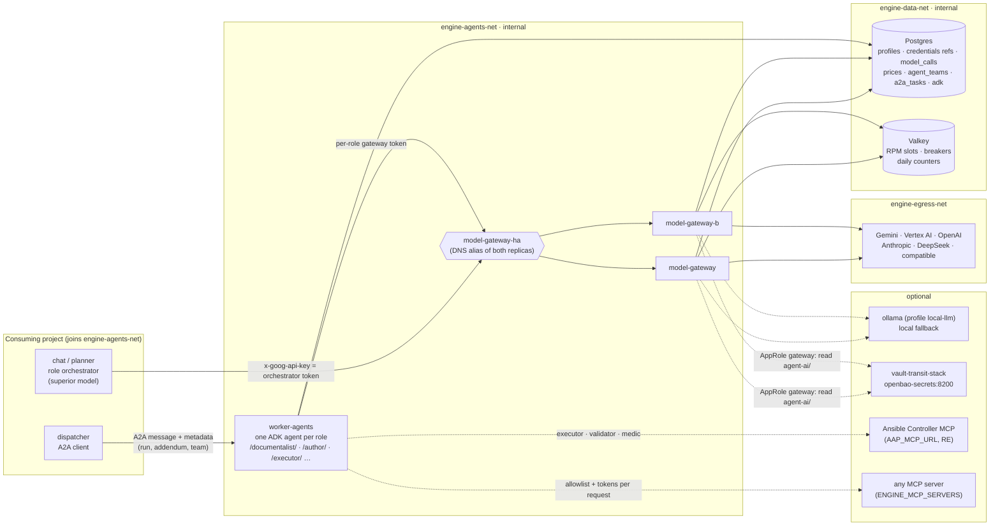
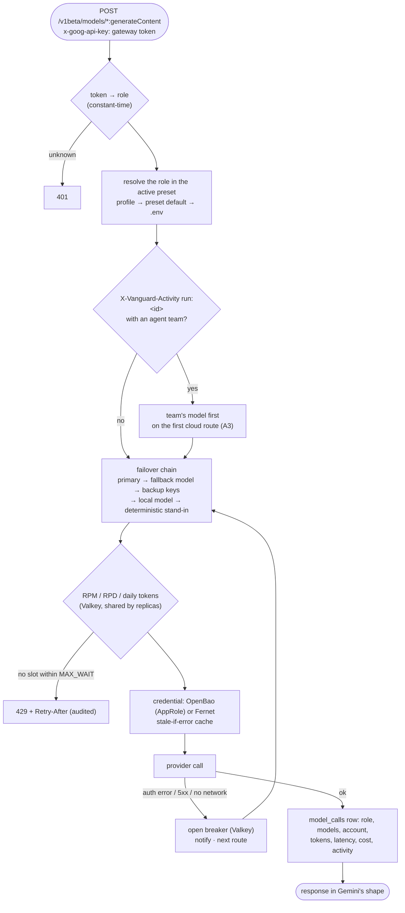
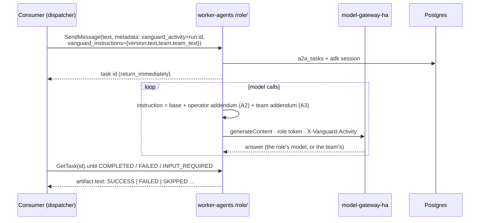
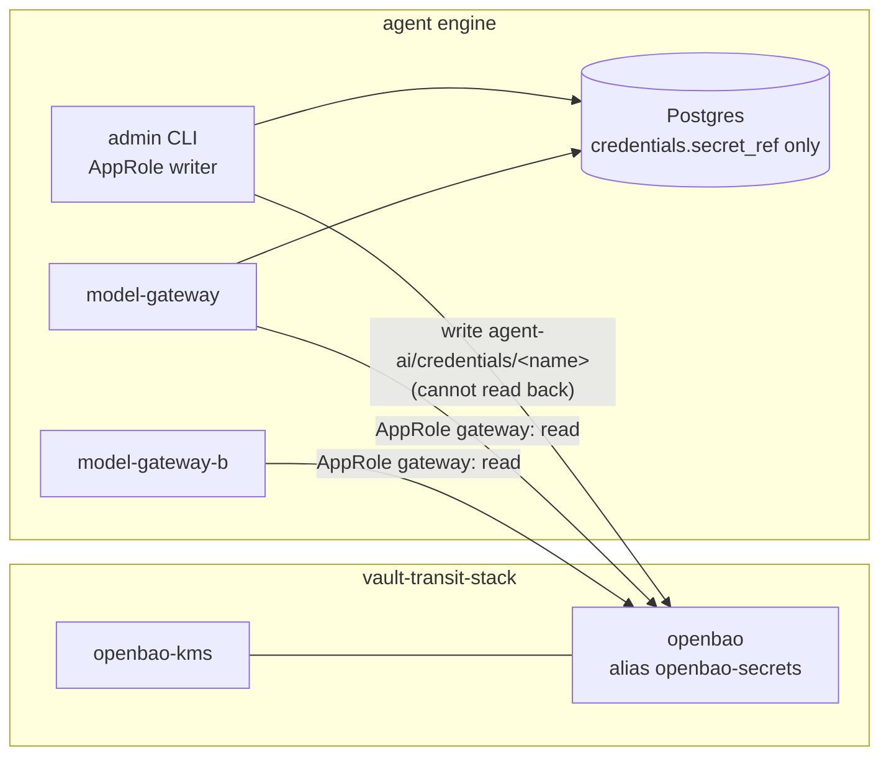

# SDK Agent Pipeline — Agent Engine

A modular **agent engine** for other projects: Google ADK agents served over **A2A**, and a
**highly available model gateway** that is the only holder of model provider keys. Extracted
from [vanguard-control](https://github.com/ancrz/vanguard-control), where both were built and
hardened (gateway F3/F20/R2, G-AGENTS A2–A4); this repository is their project-agnostic form.
Provider keys can live in [vault-transit-stack](https://github.com/ancrz/vault-transit-stack)
(OpenBao), the sibling module.

> **What changed.** This repository used to be *Topos Pipeline*: a six-stage ADK pipeline
> (Archon → Ontos → Pragma → Graphos → Dokimos → Hermon) calling Gemini directly with a
> client-side rate limiter. That design is retired (see git history before `feat!: agent
> engine`). The planning is done by the consuming application's **chat** — the superior model,
> reached through the gateway as the `orchestrator` role — and only the **smaller agent roles
> that do useful work** run here, each with its own small model, token, limits and audit.

## Purpose: an independent blueprint

The engine is **decoupled from vanguard-control**: it builds, runs and is tested on its own, and
vanguard is never needed at run time. It is kept as a protected, self-contained copy of the
technology (a failover for the code) and as a **blueprint to transplant** into any project that
needs an agentic core:

| A project that needs… | Takes |
|---|---|
| one gateway in front of every model call (keys, limits, failover, audit, cost) | `model_gateway/` + `store/` + Postgres + Valkey |
| small agents doing bounded work over A2A | `workers/` (+ the gateway) |
| its own tools for those agents | an MCP server declared in `ENGINE_MCP_SERVERS` ([docs/mcp.md](docs/mcp.md)) |
| provider keys out of the database | [vault-transit-stack](https://github.com/ancrz/vault-transit-stack) + `docker-compose.openbao.yml` |

Nothing here imports vanguard-control. The [extraction map](#extraction-map-from-vanguard-control)
says where each piece came from, so later improvements there can be carried over by hand.

---

## Architecture



| Piece | What it does |
|---|---|
| **model-gateway** ×2 | Speaks the Gemini REST protocol, so ADK/google-genai clients work unchanged with `GOOGLE_GEMINI_BASE_URL`. Each caller's "API key" is its **gateway token**; the gateway derives the role from it, resolves the role's model and credential (**the role cannot pick a pricier model**), injects the real provider key, enforces limits, walks the failover chain and writes an audit row. Two replicas answer the same DNS name; Docker's DNS returns only running containers, and all shared state is in Valkey. |
| **worker-agents** | One process serving one ADK agent per role (G-AGENTS A4), each built from an `AgentSpec` (instruction, skills, how it asks a human, which Controller tools it may call). One role is served at the root; several each under `/<role>/`. Tasks and ADK sessions persist in Postgres, so an `INPUT_REQUIRED` task survives a restart. |
| **store/** | The data contract: SQLAlchemy models, model resolution, presets, failover chains, prices, notifications, schema bootstrap (`python -m store.schema`) and the admin CLI (`python -m store.admin`). |
| **MCP tools** | Each role can use tools from MCP servers: two wired in code (the Ansible Controller's aap-mcp front, the knowledge server) and **any other declared by configuration** with an allowlist and per-request tokens — see [docs/mcp.md](docs/mcp.md). |
| **orchestrator/** | Runtime shared by gateway and workers: per-role models, Valkey RPM limiter, Fernet credentials, the OpenBao client, activity attribution, base instructions + addenda, and the deterministic stand-in. |

### Roles

| Role | Default model | Tools | Use |
|---|---|---|---|
| `orchestrator` | `VANGUARD_MODEL_ORCHESTRATOR` | — (no worker: the consumer's chat calls the gateway) | planning, chat; the superior model |
| `documentalist` | default (flash-lite) | `request_approval` | reports and traces from what it is given — **enabled by default** |
| `author` | default | `request_approval`, knowledge MCP | drafts Ansible job templates; never runs them |
| `executor` | default | `request_approval`, Controller MCP | runs approved job templates |
| `validator` | default | `request_approval`, Controller MCP (check mode) | validates state |
| `medic` | default | `raise_hand`, Controller MCP (ad hoc, bounded) | diagnoses and fixes a failed step |
| `embeddings` | `VANGUARD_EMBEDDING_MODEL` | — | vector embeddings through the gateway |

`executor`, `validator` and `medic` need an Ansible Controller's MCP front (vanguard-control's
`aap-mcp`); add them to `ENGINE_AGENT_ROLES` with `AAP_MCP_URL` set.

---

## How a call is routed



Bodies are never stored or logged. Notifications (`gateway.breaker_opened`, `failover`,
`local_fallback`, `internet_down`, `recovered`, `last_resort`, `secrets.unavailable`) are rows
in `notifications`, grouped by key, and log lines.

## How a task reaches an agent



The metadata contract (`orchestrator/instructions.py`, `orchestrator/activity.py`):

| Key | Value | Effect |
|---|---|---|
| `vanguard_activity` | `run:<uuid>` | the gateway attributes the calls (and their cost) to that run, and applies the run's agent team |
| `vanguard_instructions` | JSON `{"version": n, "text": "...", "team": "name", "team_text": "..."}` | added under the base instruction of tunable roles (executor, validator, medic); cannot remove the base |
| `vanguard_worker_token` | the Controller's per-node token | the Controller MCP's bearer; never in model-visible text |

---

## Quick start

```bash
git clone https://github.com/ancrz/sdk-agent-pipeline.git
cd sdk-agent-pipeline
python3 scripts/bootstrap_env.py          # .env with generated passwords and tokens
./scripts/build.sh                        # base → model-gateway → worker
docker compose up -d --wait               # postgres, valkey, schema, gateway ×2, worker-agents

# Offline first: every answer from the deterministic stand-in, no key needed
docker compose --profile admin run --rm admin preset activate offline
./scripts/smoke.sh
```

Expected:

```text
[ok] model-gateway /healthz 200
[ok] model-gateway-b /healthz 200
[ok] model-gateway-ha /healthz 200
[ok] orchestrator → gateway 200 in 0.3s: '{"title": "Plan", …'
[ok] worker-agents serves one role at the root: vanguard_documentalist
[ok] A2A documentalist: TASK_STATE_COMPLETED in 1.0s
```

Then a real provider:

```bash
echo -n "$GEMINI_KEY" | docker compose --profile admin run --rm -T admin \
  credential put gemini-main --provider gemini --tier paid
docker compose --profile admin run --rm admin profile set default --model gemini-3.5-flash-lite --credential gemini-main
docker compose --profile admin run --rm admin profile set orchestrator --model gemini-3.5-pro --credential gemini-main
docker compose --profile admin run --rm admin preset activate custom
docker compose --profile admin run --rm admin status
```

(Or just set `GOOGLE_API_KEY` in `.env`: the gateway's last resolution step.)

---

## With OpenBao (vault-transit-stack)



```bash
# 1. the store (its default consumers.json declares agent-ai/, gateway and writer)
(cd ../vault-transit-stack && ./scripts/start.sh)

# 2. the engine: in .env
#    COMPOSE_FILE=docker-compose.yml:docker-compose.openbao.yml
#    VANGUARD_SECRET_BACKEND=openbao
#    VAULT_STACK_DIR=../vault-transit-stack
docker compose up -d --wait
echo -n "$GEMINI_KEY" | docker compose --profile admin run --rm -T admin credential put gemini-main --provider gemini
```

Postgres then holds only `secret_ref = agent-ai/credentials/gemini-main`. The gateway logs in
with its own AppRole (bound to the store's secrets subnet), caches a read for
`VANGUARD_SECRET_CACHE_S` and serves the last value for `VANGUARD_SECRET_STALE_S` if the store
is sealed or unreachable; with nothing cached, reads **fail closed**.

---

## MCP tools for the agents

The blueprint is [docs/mcp.md](docs/mcp.md). In short:

```jsonc
// ENGINE_MCP_SERVERS (or a file: ENGINE_MCP_SERVERS_FILE=/app/config/mcp/servers.json)
[{ "name": "tickets", "url": "http://tickets-mcp:8000/mcp", "roles": ["documentalist"],
   "tools": ["search_tickets", "get_ticket"],
   "auth": { "type": "bearer_env", "env": "TICKETS_MCP_TOKEN", "forward_worker_token": "X-Engine-Worker-Token" } }]
```

- **Allowlist only**: the model sees the listed tools and nothing the server adds later.
- **No secret in the declaration**: tokens live in `config/mcp/tokens.env` (gitignored), the only
  environment file the worker loads; the task's own token is forwarded per request.
- **Fail closed**: a bad declaration stops the worker at start.
- **Prove it**: `docker compose --profile mcp-example up -d` starts a reference server
  (`echo`, `utc_now`, `whoami`, and a `delete_everything` the allowlist hides), then
  `docker compose exec worker-agents python -m workers.mcp_servers check --call whoami`.

The Ansible Controller connection (`aap_mcp_toolset`, the official aap-mcp-server in front of
vanguard-control's ansible-core Controller) stays in code as the reference implementation.

---

## Agent teams and addenda

```bash
docker compose --profile admin run --rm admin team set sql-scripts \
  --role executor --model gemini-3.5-flash --addendum "Prefer psql; quote every identifier."
docker compose --profile admin run --rm admin run new nightly-report --team sql-scripts
# → <run id> and the A2A metadata to send with the executor's tasks
```

A run with a team makes the gateway put the team's model first for the roles it names (cloud
routes only; offline and local chains stay reproducible). The addendum travels in the task's
metadata, after the operator's (A2) and under the base instruction.

---

## Operations

| Task | Command |
|---|---|
| Status: preset, profiles, credentials, teams, call counts | `docker compose --profile admin run --rm admin status` |
| Switch preset (no restart) | `… admin preset activate offline \| demo-free \| paid \| custom \| local` |
| More roles in the worker | `ENGINE_AGENT_ROLES=documentalist,author` → `docker compose up -d worker-agents` |
| What each MCP server offers each role | `docker compose exec worker-agents python -m workers.mcp_servers check [--call TOOL --args '{}']` |
| Local model fallback | `docker compose --profile local-llm up -d` (Ollama; only the gateway reaches it) |
| Calls and cost per role | `docker compose exec postgres psql -U engine -c "select role, count(*), sum(cost_usd) from model_calls group by 1"` |
| Notifications | `… psql -U engine -c "select event, severity, title, count, last_at from notifications order by last_at desc"` |
| Gateway admin API (agents network) | `GET /admin/serving`, `DELETE /admin/breakers?prefix=…` with `Authorization: Bearer $VANGUARD_GATEWAY_ADMIN_TOKEN` |
| Tests (120) | `pip install -r agents/base/requirements.txt pytest pytest-asyncio aiosqlite && pytest` |

---

## Troubleshooting

| Symptom | Cause and fix |
|---|---|
| `worker-agents` unhealthy, logs `ENGINE_MCP_SERVERS: …` | a bad MCP declaration (empty allowlist, unknown role, inline secret, missing token variable): fix it, `docker compose up -d worker-agents` |
| `/healthz` 404 on the worker | one role is served at the root (its card at `/.well-known/agent-card.json`); `/healthz` and `/<role>/` exist with two or more roles |
| `401` from the gateway | the caller's token is not one of `VANGUARD_GATEWAY_TOKEN_<ROLE>` (a worker serving several roles sends each role's own token per request) |
| `429` with `Retry-After` | the RPM slot did not free within `VANGUARD_GATEWAY_MAX_WAIT_S`; raise the limit or the profile's `rpm`, or use another account |
| every answer is "Deterministic …" | the active preset is `offline`, or every route failed and the stand-in answered (`notifications`: `gateway.last_resort`) |
| `gateway.breaker_opened` | an account answered an auth error: fix the key (`credential put` again), then `DELETE /admin/breakers?prefix=account:<name>` |
| `secrets.unavailable` / OpenBao refused | the AppRole directory is not mounted or not readable (`HOST_GID`), the gateway is not on `bao-secrets-net`, or `BAO_ADDR` is not `https://openbao-secrets:8200` |
| `check` reports `401` for an MCP server | the token in `config/mcp/tokens.env` differs from the server's |

---

## Configuration

`.env.example` documents every variable. The essentials:

| Variable | Default | Description |
|---|---|---|
| `VANGUARD_GATEWAY_TOKEN_<ROLE>` | generated | one token per role: the gateway derives role, model and limits from it |
| `VANGUARD_GATEWAY_ADMIN_TOKEN` | generated | the gateway's admin API |
| `VANGUARD_DEFAULT_MODEL` / `VANGUARD_MODEL_<ROLE>` | `gemini-3.5-flash-lite` / empty | the `.env` step of model resolution |
| `ENGINE_AGENT_ROLES` | `documentalist` | roles served by `worker-agents` |
| `ENGINE_MCP_SERVERS` / `ENGINE_MCP_SERVERS_FILE` | empty | MCP servers for the agents ([docs/mcp.md](docs/mcp.md)) |
| `VANGUARD_SECRET_BACKEND` | `local` | `local` (Fernet, `VANGUARD_CREDENTIALS_KEY`) or `openbao` |
| `VANGUARD_BAO_MOUNTS` | `{"model_provider":"agent-ai"}` | the store's mount names (vanguard-control uses `vanguard-ai`) |
| `VANGUARD_GATEWAY_RPM_FREE` / `_PAID` / `VANGUARD_GATEWAY_RPM` | `10` / `0` / empty | requests per minute per account and model (0 = unlimited) |
| `VANGUARD_GATEWAY_MAX_WAIT_S` | `30` | how long a request waits for its RPM slot before a 429 |
| `VANGUARD_LLM_MODE` | `gemini` | `deterministic`: the first schema run seeds the offline preset active |

Variables keep vanguard-control's `VANGUARD_*` names, so code and settings move between both
projects unchanged.

---

## Project structure

```text
sdk-agent-pipeline/
├── docker-compose.yml           # postgres, valkey, schema, model-gateway ×2, worker-agents (+ admin, local-llm, mcp-example)
├── docker-compose.openbao.yml   # overlay: AppRoles and the secrets network of vault-transit-stack
├── .env.example
├── agents/base/                 # base image: ADK, A2A, MCP, FastAPI, SQLAlchemy, Valkey
├── model_gateway/               # the gateway (app, providers, failover, local models, signatures) + tests
├── workers/                     # AgentSpec registry, ADK agent factory, A2A entrypoint, mcp_servers.py
├── config/mcp/                  # servers.example.json, tokens.env.example (tokens.env is gitignored)
├── examples/mcp-example/        # a reference MCP server to prove a connection
├── docs/mcp.md                  # the MCP blueprint
├── orchestrator/                # runtime: models, ratelimit, credentials, secrets, activity, instructions, deterministic
├── store/                       # models, services, prices, schema bootstrap, admin CLI
├── tests/                       # activity header, OpenBao client, workers, MCP servers (against the example)
└── scripts/                     # bootstrap_env.py, build.sh, smoke.sh / smoke.py
```

### Extraction map (from vanguard-control)

| Here | vanguard-control | Adaptation |
|---|---|---|
| `model_gateway/` | `model_gateway/` | imports `api.*` → `store.*`; the agent team is read through `activity_runs.agent_team_id` (there: run → plan → team) |
| `workers/` | `workers/` | `mcp_servers.py` added (declared MCP servers); `agent.py` appends their toolsets |
| `orchestrator/` | `activity, credentials, secrets, models, deterministic, stepparams, ratelimit, instructions` | `secrets.mounts()`: mount names from `VANGUARD_BAO_MOUNTS` |
| `store/models/` | `api/models/automation.py`, `activity.py`, `notification.py` | only the gateway's tables; runs and notifications without plans, users or inventories |
| `store/services/` | `api/services/models, presets, failover, prices, credentials, notify` | `notify`: no recipients (rows + logs); `credentials`: `store()` only |
| `store/schema.py` | Alembic history | `create_all` + `a2a_tasks` from a2a-sdk + schema `adk` + seeds |
| `store/admin.py` | the API's AI Gateway screens | CLI |

Not extracted (vanguard-control's domain): the plan graph compiler and SDD planner, the
Controller and its MCP front, the knowledge MCP, users/RBAC, the operator's versioned addenda
store (the engine receives addenda in the metadata). Comments that cite `docs/pipeline/*`
refer to vanguard-control's design records.
