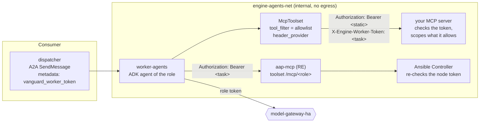
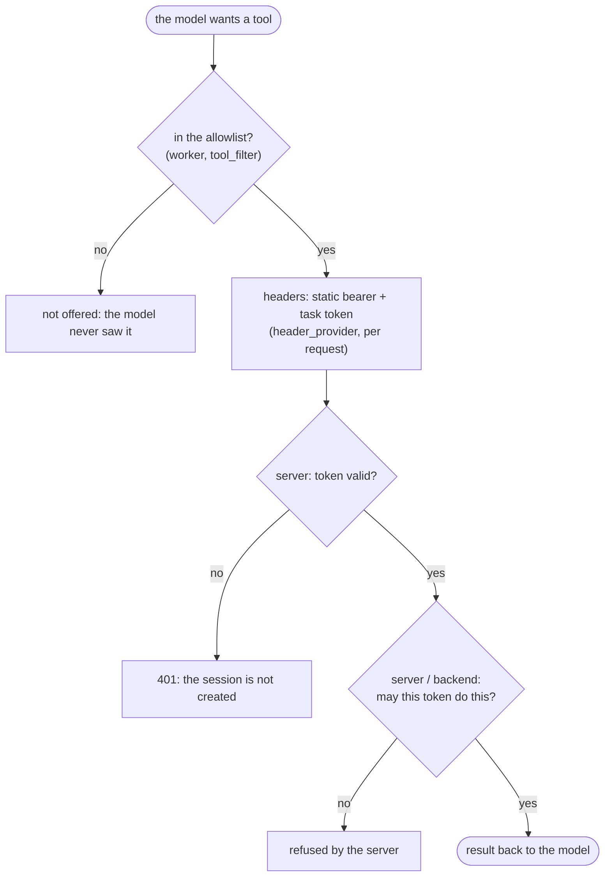

# Connecting MCP servers to the engine

The worker agents reach tools through **MCP servers** (Model Context Protocol, Streamable HTTP).
This is the blueprint: how a server is attached, what travels with each request, where the
guardrails sit, and how to prove a connection. Two connections are written in code and stay
as the reference implementation (RE); any other server is attached by **configuration**.

| Connection | Where | How it is attached | Roles |
|---|---|---|---|
| Ansible Controller (aap-mcp) | `workers/agent.py` `aap_mcp_toolset` | code, `AAP_MCP_URL` | executor, validator, medic |
| Knowledge (read-only) | `workers/agent.py` `knowledge_toolset` | code, `KNOWLEDGE_MCP_URL` + `VANGUARD_KNOWLEDGE_TOKEN` | every role |
| **Any other MCP server** | `workers/mcp_servers.py` | **`ENGINE_MCP_SERVERS`** (JSON) or **`ENGINE_MCP_SERVERS_FILE`** | the roles you list |
| Example (to prove it) | `examples/mcp-example/server.py` | compose profile `mcp-example` + `config/mcp/servers.example.json` | documentalist |

---

## 1. The pattern



1. **The model sees only the allowlist.** `tool_filter` lists the tools by name; anything else
   the server offers (now or after an upgrade) never reaches the model. There is no "all
   tools" form.
2. **Credentials never enter model-visible text.** A static token comes from the worker's
   environment (`auth.type: bearer_env`); the task's own token comes from the A2A metadata
   (`vanguard_worker_token`) through ADK's `header_provider`, on every request.
3. **The server decides.** The allowlist limits what is *offered*; the server must still check
   the token and scope what the token may do (the aap-mcp front + Controller do exactly that).
4. **The network bounds it.** The worker is on internal networks only (no egress). An MCP
   server it calls must be on `engine-agents-net` (or another network you attach to
   `worker-agents`); a server that needs the internet gets its own egress network, not the
   worker.
5. **A bad declaration stops the start.** Malformed JSON, an unknown role, an empty allowlist,
   an inline secret or a missing token variable raise `McpConfigError` and the worker exits.



---

## 2. Declaring a server

`ENGINE_MCP_SERVERS` (a JSON list) or `ENGINE_MCP_SERVERS_FILE` (a file with the same list;
`config/mcp/` is mounted read-only at `/app/config/mcp`):

```json
[
  {
    "name": "tickets",
    "url": "http://tickets-mcp:8000/mcp",
    "roles": ["documentalist", "author"],
    "tools": ["search_tickets", "get_ticket"],
    "auth": { "type": "bearer_env", "env": "TICKETS_MCP_TOKEN", "forward_worker_token": "X-Engine-Worker-Token" },
    "prefix": "tickets",
    "note": "Read tickets to cite them in reports; you cannot change them.",
    "timeout": 10
  }
]
```

| Field | Required | Meaning |
|---|---|---|
| `name` | yes | `[a-z][a-z0-9_]*`, unique; shown in logs, in `check` and in the instruction note |
| `url` | yes | the Streamable HTTP endpoint (`http://` inside the stack, `https://` across hosts) |
| `roles` | yes | which agents get the tools: `executor`, `validator`, `documentalist`, `author`, `medic` |
| `tools` | yes | **the allowlist**, tool names exactly as the server lists them |
| `auth.type` | no (`none`) | `none` · `bearer_env` (static token from env `auth.env`, sent as `Authorization: Bearer`) · `worker_token` (the task's token, header `auth.header`, default `Authorization`) |
| `auth.forward_worker_token` | no | with `bearer_env`: also send the task's token in this header |
| `prefix` | no | rename tools to `<prefix>_<tool>` (two servers with the same tool names) |
| `note` | no | one line added to the role's instruction |
| `timeout` | no (10) | connection timeout in seconds |

Secrets are refused in the declaration (`token`, `password`, `secret`, `api_key`, `bearer`,
`authorization` keys): put the value in **`config/mcp/tokens.env`** (gitignored), which only
`worker-agents` (and the example server) load. The project's `.env` never reaches the workers.

When a role gets declared tools, its instruction gains one line naming them (and the `note`),
so the model knows they exist; the base instruction is unchanged.

---

## 3. What the server receives

| Header | When | Value |
|---|---|---|
| `Authorization: Bearer <token>` | `bearer_env` | the variable named in `auth.env` |
| `Authorization: Bearer <task token>` | `worker_token` with the default header | `vanguard_worker_token` from the task's A2A metadata |
| `<header>: <task token>` | `forward_worker_token` / `auth.header` | the same token, raw |

The task token is whatever the dispatcher put in the A2A metadata (in vanguard-control: a
per-node token the Controller issued and checks). A server that receives it can scope its
answers to that task, exactly as the knowledge MCP scopes job history to a run's environment.

---

## 4. Proving a connection

```bash
cp config/mcp/tokens.env.example config/mcp/tokens.env       # set EXAMPLE_MCP_TOKEN to a long random value
echo 'ENGINE_MCP_SERVERS_FILE=/app/config/mcp/servers.example.json' >> .env
docker compose --profile mcp-example up -d --wait

docker compose exec worker-agents python -m workers.mcp_servers check --call whoami
```

```text
[ok] example http://mcp-example:8000/mcp → roles documentalist: echo, utc_now, whoami
     whoami: {… "authorization": "present (…3e0b)", "x_engine_worker_token": "absent" …}
```

- `delete_everything` exists on the server but is not listed: the allowlist works.
- `authorization: present` shows the static bearer arrived (only its last 4 characters are
  ever shown); `x_engine_worker_token` is `absent` here because `check` runs outside a task
  and shows `present` inside one.
- With a wrong token the check reports `401 Unauthorized` and exits non-zero.

`check` connects to every declared server and lists what each would offer; use it after any
change to the declaration. The same behaviour is pinned by `tests/test_mcp_servers.py`, which
starts the example server in-process: allowlist, both tokens, values never echoed, 401
without a token, and every refusal of a bad declaration.

---

## 5. The reference: Ansible's aap-mcp (RE)

vanguard-control runs the official **ansible/aap-mcp-server** (Apache-2.0), built from source
at a pinned commit, with its own `aap-mcp.yaml`, in front of its own **Ansible Controller**
(ansible-core based, with an AWX-compatible API). The engine keeps that connection in code
(`aap_mcp_toolset`) because it is the pattern this blueprint generalises:

| Layer | aap-mcp (vanguard-control) | Any server (here) |
|---|---|---|
| What is offered per role | server side: `toolsets.<role>` in `aap-mcp.yaml`, served at `/mcp/<role>` | the server's own tool list |
| What the model may see | `AgentSpec.controller_tools` → `tool_filter` | `tools` → `tool_filter` |
| Credential per request | the node's worker token → `Authorization: Bearer` | `worker_token` / `forward_worker_token` |
| Who enforces | the Controller re-checks the token's grant (template, target, job type, remedy) | your server |
| Where it lives | `vanguard-agents-net` / `vanguard-automation-net` | `engine-agents-net` |

To connect executor, validator or medic to a Controller, set `AAP_MCP_URL` (for example
vanguard-control's `http://aap-mcp:3000`, with the engine's worker on that network) and add the
roles to `ENGINE_AGENT_ROLES`.

---

## 6. Checklist for a new server

1. Put the server on `engine-agents-net` (or attach a network to `worker-agents`); no host port needed.
2. Expose Streamable HTTP; restrict accepted `Host` headers (DNS-rebinding protection).
3. Require a token; if tasks must be told apart, accept the task token and scope answers by it.
4. Declare it with the **smallest allowlist** that does the job and only the roles that need it.
5. Put any static token in `config/mcp/tokens.env`; reference it by name.
6. `docker compose up -d worker-agents` (a bad declaration stops it: read `docker compose logs worker-agents`).
7. `docker compose exec worker-agents python -m workers.mcp_servers check`.
